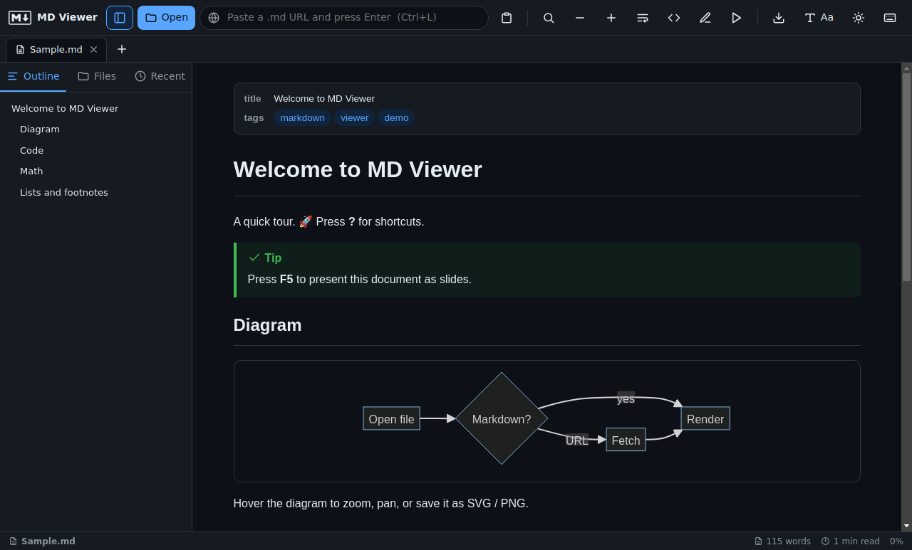
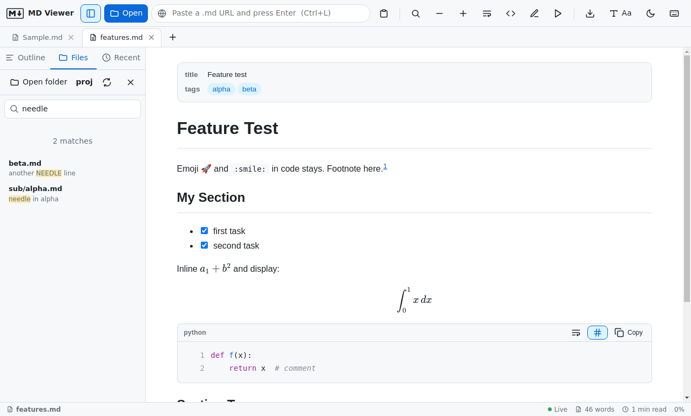

<div align="center">


# MD Viewer

**A tiny, fast Markdown viewer for Windows, written in C++.**
Mermaid diagrams · LaTeX math · syntax highlighting · tabs · live reload · online media

[](https://github.com/YOUR-USERNAME/md-viewer/actions)
[](LICENSE)



</div>

## Download

<div align="center">

[-0969da?style=for-the-badge&logo=windows&logoColor=white)](https://github.com/YOUR-USERNAME/md-viewer/raw/main/installer/MD-Viewer-Setup.exe)

**One click** - about 1.6 MB, straight from this repository. Also on the [Releases page](https://github.com/YOUR-USERNAME/md-viewer/releases/latest).
Prefer no install? Use the [portable zip](https://github.com/YOUR-USERNAME/md-viewer/raw/main/installer/MD-Viewer-portable.zip).

</div>

1. Click the button and run `MD-Viewer-Setup.exe`.
2. Windows SmartScreen may show "Unknown publisher" because the installer is not code-signed yet.
   Click **More info > Run anyway**. See [SIGNING.md](SIGNING.md).
3. The installer adds Start Menu and desktop shortcuts and makes MD Viewer the app for `.md` / `.markdown` files,
   so a double-click opens them. No admin rights needed (per-user install).

**Requires** the Microsoft Edge WebView2 Runtime, which is already part of Windows 11 and current Windows 10.
If it is missing, MD Viewer offers a link to install it.
Verify downloads against [`installer/SHA256.txt`](installer/SHA256.txt) (`certutil -hashfile <file> SHA256`).

## Features

| | |
|---|---|
| **Open anything** | File dialog, **drag and drop**, command line, double-click in Explorer, paste, or load a URL (GitHub `blob` links are converted to raw automatically). Files in UTF-8, UTF-16 or Windows ANSI |
| **Folders** | Open a folder to browse a file tree and **search inside every Markdown file** with highlighted snippets |
| **Tabs** | Drag to reorder, pin, right-click menu (close others, copy path, open containing folder, reload), and **tabs reopen after a restart** |
| **Live reload** | Files opened from disk are watched; edit in any editor and the viewer updates in place |
| **Edit mode** | Side-by-side editor with live preview and `Ctrl+S`; tick boxes (`- [ ]`) can be clicked in the preview and are saved to the file |
| **Present** | `F5` turns headings into full-screen slides |
| **Mermaid** | Diagrams load on demand; **zoom, pan, copy SVG, save SVG / PNG** |
| **LaTeX math** | `$inline$`, `\(inline\)`, `$$display$$`, `\[display\]` via KaTeX |
| **Code** | Multi-colour syntax highlighting (50+ languages, auto-detect), line numbers, wrap toggle (toolbar / `Alt+Z`), one-click copy |
| **More Markdown** | YAML front matter shown as a card, footnotes, emoji shortcodes (`:rocket:`), callouts (`> [!NOTE]`), task lists, tables |
| **Media** | Images (click to zoom), `mp4`/`webm` video, `mp3`/`wav` audio, YouTube; relative paths resolve against the file or URL |
| **Reading comfort** | Light / Dark / Sepia / **High contrast**, 14 Windows reading fonts, 4 code fonts, text zoom, focus mode, **custom CSS** |
| **Export** | HTML, **PDF with paper size and margins**, **Word (.docx)**, print, copy markdown |
| **Fast on big files** | Highlighting, math and diagrams are rendered only as you scroll to them |

Press `?` in the app for all keyboard shortcuts. `Check for updates` (in the shortcuts dialog) works once you set `UPDATE_REPO` in `src/app.js`.

<div align="center">



</div>

## Build from source

Needs Node.js 18+ (to fetch the web libraries) and MinGW-w64 (cross-compiler). On Linux / WSL:

```bash
sudo apt install g++-mingw-w64-x86-64-posix binutils-mingw-w64-x86-64 nsis zip
git clone https://github.com/YOUR-USERNAME/md-viewer.git && cd md-viewer
npm ci                 # installs marked, mermaid, KaTeX, highlight.js and copies them into src/lib
./cpp/build.sh         # -> cpp/dist/mdviewer.exe, MD-Viewer-Setup.exe, MD-Viewer-portable.zip
```

After building a new version, copy the installer and zip to `installer/` and refresh `installer/SHA256.txt`
so the download button serves the latest build. Pushing a tag such as `v1.3.1` makes GitHub Actions build the
installer and attach it to a release. Details: [cpp/README.md](cpp/README.md).

## Tests

```bash
npm ci && npm i --no-save electron@31     # electron is only needed for the UI tests
xvfb-run -a npm run test:ui                # on Windows/macOS: npm run test:ui
```

The UI tests run the real interface in Chromium against a stand-in host that mirrors the C++ bridge, including the hostile-document
and file-access checks. The C++ helpers have their own self-test (`cpp/selftest.cpp`).

## Project layout

```
cpp/              C++ application: window host, WebView2 start-up, file bridge, installer script
src/viewer.html   UI markup and styles
src/app.js        UI logic (rendering pipeline, tabs, folders, edit, export)
tests/ui/         UI regression tests (stand-in host + security checks)
scripts/vendor.js Copies marked, mermaid, KaTeX and highlight.js into src/lib (generated, git-ignored)
build/            Icons
installer/        Prebuilt installer, portable zip, SHA-256 checksums
examples/         Sample documents to try
```

## Security model

Markdown can contain raw HTML, so the viewer treats every document as untrusted:

- **HTML is sanitised** (DOMPurify) before display: scripts, event handlers, `javascript:` links, iframes, forms, styles and inline CSS are removed. Mermaid runs in strict mode.
- **The page cannot reach the network** (Content-Security-Policy `connect-src 'none'`). Remote documents are downloaded by the C++ host with WinHTTP. Web security is **on**.
- **File access is allow-listed in the host.** The page can only read or write Markdown files you chose (dialog, double-click, drop, folder). A document cannot read other files, follow `..` out of its folder, or write anywhere else.
- **Navigation is locked.** The window never leaves the viewer; `http(s)` and `mailto` links open in your default browser, other schemes are refused.
- Images and videos from the web still load (that is what a viewer is for), so a document can tell a server that it was opened.

Details and tests: [cpp/README.md](cpp/README.md), `tests/ui/`.

## Contributing

Issues and pull requests are welcome, see [CONTRIBUTING.md](CONTRIBUTING.md).
Ideas: sanitising untrusted HTML, drag-and-drop with real paths, more languages, custom CSS themes.

## License

[MIT](LICENSE) © Soumyakanta Bera. Third-party libraries and the logo are listed in [THIRD_PARTY_NOTICES.md](THIRD_PARTY_NOTICES.md).
