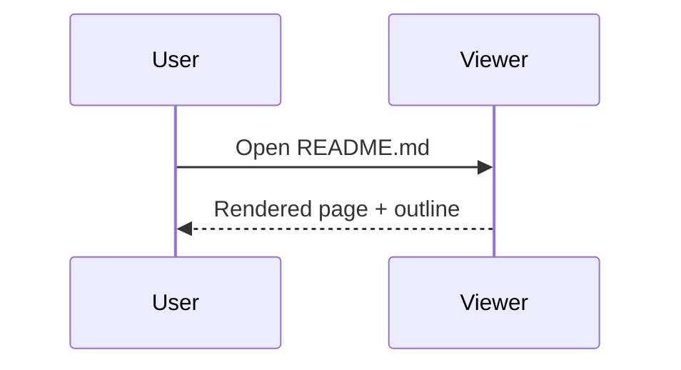

# MD Viewer demo

> [!TIP]
> Open this file with **File > Open**, drag it onto the window, or double-click it after installing.

## Mermaid



## Code

```python
def greet(name: str) -> str:
    return f"Hello, {name}!"  # syntax highlighted
```

## Math

Inline $E = mc^2$ or \(a^2 + b^2 = c^2\), display:

$$\int_{-\infty}^{\infty} e^{-x^2}\,dx = \sqrt{\pi}$$

## Media


| Feature | Supported |
|---|---|
| Tabs, live reload | yes |
| Export HTML / PDF | yes |

- [x] Task lists
- [ ] Your document here
