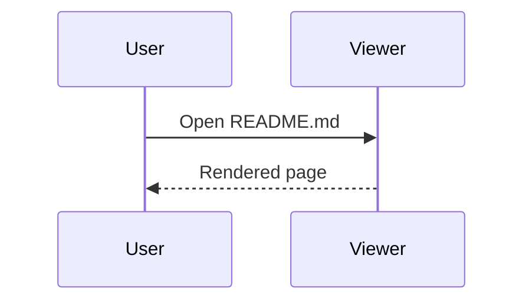

# MD Viewer feature tour :tada:

Press **F5** to present this document, **Ctrl+E** to edit it, **?** for shortcuts.

> [!NOTE]
> Front matter above is shown as a card. Footnotes work too.[^1]

## Tasks (click to tick; saved to the file)

- [x] Open a folder with **Ctrl+Shift+O**
- [ ] Search across files
- [ ] Export to Word

## Diagram (hover for zoom / save)



## Math and code

$$\sum_{k=1}^{n} k = \frac{n(n+1)}{2}$$

```python
def greet(name: str) -> str:
    return f"Hello, {name}!"
```

## Table

| Feature | Where |
|---|---|
| Tabs | right-click for more |
| Export | toolbar download button |

[^1]: Footnote text.
